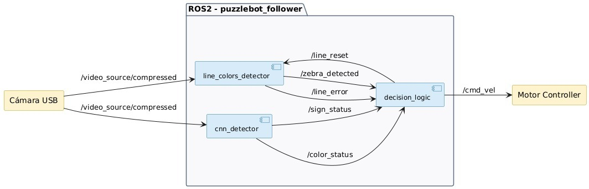

# Puzzlebot: seguimiento de línea y navegación con señales

Proyecto de robótica móvil desarrollado en equipo para el **MCR2 Final Challenge del Tecnológico de Monterrey, junio de 2026**, con **ROS 2 Humble, Python, OpenCV y YOLOv8**, según el reporte técnico. Integra percepción visual, seguimiento de línea con control PD y una máquina de estados que coordina la respuesta a semáforos, señales e intersecciones.

El reto consiste en convertir imágenes de una cámara en decisiones de movimiento: seguir una trayectoria, reducir la velocidad, detenerse y ejecutar maniobras según los elementos detectados en la pista. El escenario descrito en el reporte es una Puzzletrack modular de MDF con forma de «b», rectas, curvas y cruces con paso cebra.

## Qué implementa

- **Seguimiento visual:** segmentación de una línea oscura sobre un fondo claro, selección del centroide por continuidad y cálculo de error lateral normalizado.
- **Percepción de señales y semáforos:** inferencia con un modelo personalizado de YOLO y publicación de resultados como mensajes ROS 2.
- **Detección de cruce tipo cebra:** filtrado geométrico de contornos y acumulación de evidencia entre ciclos.
- **Control de movimiento:** corrección PD y reducción de velocidad conforme aumenta el error de línea.
- **Coordinación de comportamientos:** parada temporal, zona de obras, aproximación a intersecciones, espera de luz verde y maniobras temporizadas.

Estos puntos describen funciones presentes en el código. El reporte aporta resultados resumidos; su alcance y las metas aún no acreditadas se distinguen en la sección de resultados y en la [guía de evaluación](docs/EVALUACION.md).

## Arquitectura



*Figura 1 del reporte técnico del equipo, página impresa 6. Los nombres de los bloques representan módulos; los ejecutables y nombres ROS exactos se detallan en [Arquitectura](docs/ARQUITECTURA.md).*

La visión de línea procesa el **40 % inferior** de la imagen; el detector de señales utiliza el **60 % superior**. La inferencia se ejecuta en un hilo separado para evitar bloquear los callbacks de ROS. El control y la visión de línea tienen temporizadores configurados a **20 Hz**; esto no representa una medición de rendimiento ni la frecuencia garantizada de inferencia.

## Decisiones de ingeniería

| Decisión | Propósito y compromiso |
|---|---|
| Separar percepción y control mediante tópicos | Permite observar y depurar cada componente; requiere controlar la vigencia de los datos recibidos. |
| CLAHE, desenfoque y umbral de Otsu | Mejorar la segmentación ante variaciones de contraste; la respuesta debe evaluarse en la iluminación real de la pista. |
| Seleccionar el centroide cercano al anterior | Mantener continuidad; puede retener una selección equivocada si cambia la escena. |
| Acumular evidencia de señales y cebra | Evitar cambios por una detección aislada; añade demora y depende de la frecuencia de procesamiento. |
| Separar control PD y lógica de estados | Mantener explícitas las prioridades y transiciones de comportamiento. |
| Maniobras con velocidades y tiempos fijos | Simplificar el cruce; su precisión depende de calibración, batería y adherencia, sin corrección por odometría. |

## Estructura del proyecto

```text
puzzlebot_follower/
├── README.md
├── config/params.yaml              # Ganancias, velocidades, tiempos y modelo
├── launch/followe.launch.py        # Inicio del sistema integrado
├── puzzlebot_follower/
│   ├── line_colors_detector.py     # Visión activa: línea y cebra
│   ├── cnn_detector.py             # Semáforos y señales con YOLO
│   ├── decision_logic.py           # Control PD y máquina de estados
│   ├── line_detector.py            # Variante de visión con imagen sin comprimir
│   └── fuzzy_controller.py         # Alternativa experimental de control difuso
├── docs/                          # Arquitectura, instalación y evaluación
├── test/                          # Pruebas de estilo generadas para ROS 2
├── resource/puzzlebot_follower
├── package.xml
├── setup.cfg
└── setup.py
```

El lanzamiento principal ejecuta `final_detector`, `cnn_detector` y `decision_logic`. El controlador difuso está incluido como alternativa experimental: **no participa en ese lanzamiento ni tiene un ejecutable registrado en `setup.py`**.

## Cómo ejecutarlo

El entorno de desarrollo reportado es **ROS 2 Humble**. Para reproducirlo también se necesitan el paquete externo `my_interfaces`, los pesos entrenados del detector, una fuente de imágenes y el controlador de la base. Esos componentes no vienen en esta carpeta.

Una vez completados los requisitos, configurado el modelo y compilado el workspace:

```bash
source /opt/ros/humble/setup.bash
source ~/ros2_ws/install/setup.bash
ros2 launch puzzlebot_follower followe.launch.py
```

El nombre del archivo es `followe.launch.py`, tal como aparece en el repositorio. Consulta la [guía de instalación y ejecución](docs/INSTALACION.md) antes de iniciar el robot.

## Documentación técnica

- [Arquitectura, tópicos y máquina de estados](docs/ARQUITECTURA.md).
- [Instalación, dependencias y diagnóstico](docs/INSTALACION.md).
- [Parámetros y ajustes](docs/PARAMETROS.md).
- [Estado de validación, limitaciones y plan de evaluación](docs/EVALUACION.md).
- [Diagramas del reporte, procedencia y diferencias con el código](docs/REPORTE.md).

## Resultados documentados

El reporte técnico de junio de 2026 presenta los siguientes resultados resumidos. No se incluyen registros individuales ni videos que permitan verificarlos de forma independiente.

| Prueba | Resultado declarado en el reporte | Alcance |
|---|---|---|
| Seguimiento de línea con tres condiciones de iluminación | ≥95 % de éxito | No incluye el desglose de intentos que permita reconstruir el porcentaje. |
| Detección de señales y semáforos | Detección confiable a ≥0.8 m y estable a ≥0.4 m; 0 falsos positivos | No incluye desglose por clase ni número de observaciones. |

Para la vuelta completa, **≥4 de 5 intentos, cero infracciones de semáforo y menos de 120 s aparecen como resultados esperados**, no como una tabla de resultados obtenidos. Consulta [Evaluación](docs/EVALUACION.md) para el contexto y las evidencias pendientes.

## Trabajo en equipo

**Jesús Emiliano García Jiménez y Hector Castillo Guerra.**

Ambos integrantes participaron en las distintas áreas: percepción, control, integración y pruebas. Las decisiones y ajustes se trabajaron de forma colaborativa, sin una división exclusiva de módulos por persona.

## Estado y siguientes pasos

La entrega contiene el código de integración, su configuración y diagramas extraídos del reporte. Aún faltan los pesos del modelo, el paquete original de mensajes, un registro del entorno completo y evidencia audiovisual o registros por ensayo para reproducir y evaluar el sistema de extremo a extremo. El reporte sí documenta los campos de los mensajes y resultados resumidos.

Las siguientes mejoras son documentar esos recursos, medir el desempeño en pista, incorporar detección de datos obsoletos y pérdida de línea, y sustituir las maniobras temporizadas por control con realimentación.

## Licencia

La licencia está pendiente de confirmación por los autores: `setup.py` declara `Apache-2.0`, mientras que `package.xml` conserva un marcador pendiente y no se incluye un archivo `LICENSE`. Los archivos de pruebas mantienen sus avisos originales. Esta documentación no establece una licencia nueva.
