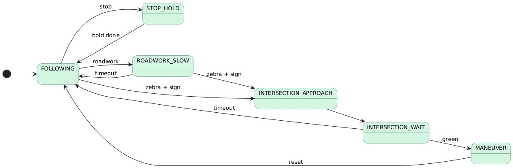
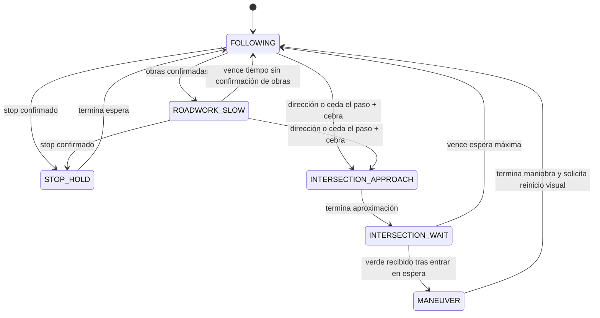

# Arquitectura y comportamiento

[Volver al README](../README.md)

Esta descripción corresponde al código incluido. Distingue las rutas utilizadas por el lanzamiento principal de las alternativas experimentales.

## Nodos activos

| Ejecutable | Nombre del nodo | Archivo | Responsabilidad |
|---|---|---|---|
| `final_detector` | `line_follower_vision` | `line_colors_detector.py` | Línea y cruce tipo cebra a partir de imagen comprimida. |
| `cnn_detector` | `cnn_detector` | `cnn_detector.py` | Inferencia de señales y semáforos en un hilo independiente. |
| `decision_logic` | `puzzlebot_decision_logic` | `decision_logic.py` | Máquina de estados y publicación de velocidades. |

Las suscripciones de cámara usan `qos_profile_sensor_data`. Las publicaciones y suscripciones restantes se crean con profundidad de cola 10.

## Contrato de tópicos

Los nombres siguientes corresponden al lanzamiento sin un espacio de nombres adicional.

| Tópico | Tipo | Publicador → consumidor | Contenido |
|---|---|---|---|
| `/video_source/compressed` | `sensor_msgs/msg/CompressedImage` | Cámara externa → ambos detectores | Imagen comprimida decodificable con OpenCV. |
| `/line_error` | `std_msgs/msg/Float32` | Visión → control | Desplazamiento horizontal normalizado. |
| `/zebra_detected` | `std_msgs/msg/Bool` | Visión → control | Evidencia acumulada de cruce tipo cebra. |
| `/color_status` | `my_interfaces/msg/ColorStatus` | YOLO → control | Campos `red`, `yellow`, `green`. |
| `/sign_status` | `my_interfaces/msg/SignStatus` | YOLO → control | Campos de las siete señales. |
| `/line_reset` | `std_msgs/msg/Bool` | Control → visión | Al recibir `true`, descartar el centroide anterior. |
| `/cmd_vel` | `geometry_msgs/msg/Twist` | Control → base externa | `linear.x` y `angular.z`. |

No se incluyen los archivos `.msg` originales. El cuadro 4 del reporte (página impresa 10) documenta los siguientes campos como `bool`, coincidiendo con el uso del código. La compilación y compatibilidad deben verificarse con el paquete original `my_interfaces`.

- `ColorStatus`: `bool red`, `bool yellow`, `bool green`.
- `SignStatus`: `bool stop`, `bool give_way`, `bool ahead_only`, `bool turn_right`, `bool turn_left`, `bool roundabout`, `bool roadwork`.

## Visión de línea y cebra

1. Decodificar la imagen comprimida y conservar la imagen más reciente.
2. Recortar desde el 60 % de la altura hasta el borde inferior.
3. Convertir a grises, aplicar CLAHE (`clipLimit=2.0`, rejilla `8 × 8`) y un filtro gaussiano `5 × 5`.
4. Aplicar Otsu con umbral binario inverso, suponiendo una línea oscura sobre fondo claro.
5. Conservar contornos de área mayor a 500 píxeles cuadrados y calcular sus centroides.
6. Elegir el centroide más cercano al anterior; inicialmente se usa el centro de la imagen. Limitar cada salto al 20 % del ancho.
7. Publicar `e = (cx - floor(ancho / 2)) / (ancho / 2)`.

Si no hay un contorno válido, el error publicado es `0.0`. Actualmente ese valor también representa una línea centrada: no existe un indicador independiente de pérdida de línea.

Para la cebra, el mismo umbral se analiza buscando contornos con área entre 150 y 20 000 píxeles cuadrados, relación ancho/alto de al menos 1.3 y ancho mínimo del 5 % del ancho de imagen. Se requieren **al menos seis** candidatos. El contador aumenta o disminuye en uno, se limita a `[0, 6]` y publica `true` cuando es al menos 3. El comentario que menciona tres rectángulos no coincide con la constante efectiva de seis.

Estos contadores acumulan ciclos de procesamiento, no necesariamente imágenes nuevas: el temporizador puede reutilizar la última imagen recibida.

## Detección de señales

El detector recorta el 60 % superior de la imagen y ejecuta `YOLO(model_path)` con un umbral configurado de 0.75. Publica como máximo el semáforo de mayor confianza y la señal de mayor confianza de cada inferencia, de forma independiente.

| Etiqueta exacta del modelo | Campo publicado |
|---|---|
| `red`, `yellow`, `green` | Campo homónimo de `ColorStatus` |
| `stop` | `stop` |
| `give_way` | `give_way` |
| `flecha_derecha` | `turn_right` |
| `flecha_izquierda` | `turn_left` |
| `flecha_derecho` | `ahead_only` |
| `zona_obras` | `roadwork` |
| `glorieta` | `roundabout` |

Los nombres deben coincidir exactamente con `model.names`. El reporte identifica el modelo como YOLOv8 y describe diez clases, pero no precisa su variante ni aporta checkpoint o dataset. Algunos nombres del reporte corresponden a los campos publicados, mientras que el código espera etiquetas en español como `flecha_derecha`; para configurar el modelo se debe usar la tabla anterior. Los resultados resumidos del reporte se presentan en [Evaluación](EVALUACION.md).

Si faltan imágenes o modelo, el detector publica mensajes sin detecciones. La inferencia no comprueba que la imagen sea nueva y puede procesar repetidamente un mismo fotograma.

## Control PD

Durante los estados con seguimiento de línea:

```text
delta_e = e_actual - e_anterior
angular.z = kp * e_actual + kd * delta_e
linear.x = velocidad_base * (1 - 0.9 * min(abs(e_actual), 1))
```

`delta_e` es una diferencia por ciclo; no se divide entre el tiempo transcurrido. El código devuelve la suma con signo positivo. El reporte, sección 3.4.3 (página impresa 11), explica que la cámara entrega una imagen horizontalmente reflejada y que por ello se conserva ese signo. El comentario de `_pd_steering` que describe una inversión no coincide con esa convención. Al cambiar cámara o montaje, comprobar nuevamente la correspondencia entre error y giro. No hay una saturación explícita de `angular.z` en esta ruta.

## Máquina de estados



*Figura 2 del reporte, página impresa 11. Es un resumen del flujo; el diagrama editable siguiente incluye también la transición de obras a alto. Las condiciones completas se describen debajo.*



Los contadores de señales suman uno cuando hay detección y restan uno cuando no la hay, dentro de `[0, 2 × sign_confirm_count]`. La confirmación ocurre al alcanzar `sign_confirm_count`; **no exige una secuencia estrictamente consecutiva**.

Las señales nuevas solo cambian el estado desde `FOLLOWING` o `ROADWORK_SLOW`. La prioridad efectiva es: `stop` fuera del periodo de inhibición, `give_way`, `turn_left`, `turn_right`, `ahead_only`, `roundabout`, y finalmente `roadwork`. Ceda el paso y las cuatro direcciones requieren cebra detectada.

| Estado | Comportamiento |
|---|---|
| `FOLLOWING` | Seguimiento PD; reducción por amarillo o acumulación parcial de señales de intersección, además de la reducción por error. |
| `STOP_HOLD` | Velocidad cero durante la espera configurada; después activa un periodo de inhibición para la señal de alto. |
| `ROADWORK_SLOW` | Seguimiento PD a velocidad reducida hasta que transcurre el tiempo sin confirmación de obras. |
| `INTERSECTION_APPROACH` | Avance recto temporizado a velocidad fija, sin seguir la línea. |
| `INTERSECTION_WAIT` | Detención; limpia el indicador verde al entrar y espera otro mensaje verde. Al vencer el tiempo máximo, vuelve a seguir la línea. |
| `MANEUVER` | Movimiento de duración fija: recto, giro izquierdo, giro derecho o arco para glorieta. |

`GIVE_WAY_APPROACH` está declarado y tiene código, pero ninguna transición actual entra en él. Ceda el paso entra en `INTERSECTION_APPROACH` con dirección recta.

El rojo impone velocidad cero en todos los estados excepto `MANEUVER`. La retención se libera con verde o cuando pasan `red_timeout` segundos desde el último rojo. Mientras el rojo retiene, los temporizadores incrementales de estado no avanzan. Estos usan incrementos fijos de 0.05 s por ciclo, por lo que un retraso de ejecución altera su duración real.

## Variantes incluidas

- `line_detector.py`: consume `/video_source/raw` como `sensor_msgs/msg/Image`, usa `cv_bridge` y no publica cebra. No sustituye por sí solo toda la percepción del lanzamiento integrado.
- `fuzzy_controller.py`: usa `scikit-fuzzy`, error y cambio de error, cinco conjuntos de pertenencia y nueve reglas. No incorpora la máquina de estados completa. No hay evidencia de una comparación cuantitativa con PD.

Solo un controlador debe publicar comandos de movimiento hacia la base durante una prueba; las variantes no incluyen arbitraje entre publicadores.
