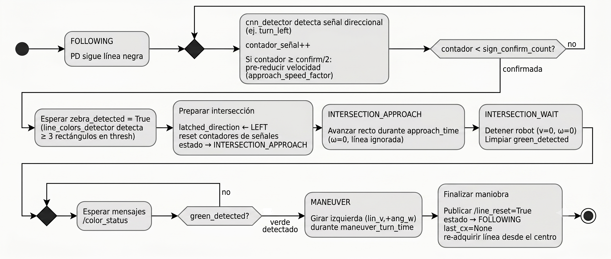

# Reporte técnico y procedencia de las imágenes

[Volver al README](../README.md)

## Fuente

**Jesús Emiliano García Jiménez y Hector Castillo Guerra.** *MCR2 Final Challenge: Conducción Autónoma con Puzzlebot*. Robótica Móvil — MCR2, Tecnológico de Monterrey, junio de 2026. Archivo proporcionado por el equipo: `Puzzlebot_Reporte.pdf`, 17 páginas.

Se incorporaron las tres imágenes embebidas en el PDF, extraídas sin modificación. El documento completo no forma parte de esta copia del repositorio. Los números impresos de página son uno menores que su posición en el PDF.

| Archivo | Figura del reporte | Página impresa / PDF | Uso |
|---|---|---|---|
| [arquitectura-reporte.jpg](images/arquitectura-reporte.jpg) | 1. Arquitectura de componentes | 6 / 7 | Vista principal en el README. |
| [estados-reporte.jpg](images/estados-reporte.jpg) | 2. Máquina de estados | 11 / 12 | Resumen visual en Arquitectura, acompañado por el flujo detallado del código. |
| [cruce-reporte.png](images/cruce-reporte.png) | 3. Flujo de cruce | 12 / 13 | Referencia original reproducida a continuación, con aclaraciones. |

## Flujo de cruce del reporte

Esta figura conserva el diseño original del equipo. **No es una especificación exacta de la versión de código incluida:**

- Menciona al menos tres rectángulos para la cebra; la constante activa exige seis candidatos, con un contador de confirmación de tres ciclos.
- El rombo pregunta `contador < sign_confirm_count?`, pero sus ramas no representan correctamente la condición de confirmación del código, que es `contador >= sign_confirm_count`.
- La reducción previa usa `max(1, confirm // 2)` en el código: con el valor actual de cinco, comienza en dos detecciones acumuladas.
- No muestra el timeout que abandona la espera y vuelve a seguimiento sin verde.
- `last_cx = None` se ejecuta en el nodo de visión al recibir `/line_reset`, no directamente dentro del controlador.

Para implementar o ajustar el sistema, usar [Arquitectura](ARQUITECTURA.md) y el código como referencia de comportamiento.

## Diferencias entre documento y versión de código

| Tema | Reporte | Código entregado / tratamiento en la documentación |
|---|---|---|
| Velocidad base | Apéndice: `max_v = 0.2` | YAML: `0.15`; se documenta el valor del YAML. |
| Factor de aproximación | Apéndice: `0.4` | YAML: `0.7`. |
| Duración de avance recto | Apéndice: `1.5 s` | YAML: `2.5 s`. |
| Duración de giro | Apéndice: `3.0 s` | YAML: `2.4 s`. |
| Histéresis | Describe fotogramas consecutivos | Contadores con incremento y decremento; los nodos pueden procesar la misma imagen varias veces. |
| Ceda el paso | Describe `GIVE_WAY_APPROACH` | El estado existe, pero los disparadores actuales entran en `INTERSECTION_APPROACH`. |
| Signo del PD | Cámara horizontalmente reflejada, signo positivo | Coincide con la fórmula del código; el comentario de inversión está desactualizado. |
| Clases YOLO | Enumera nombres funcionales en inglés | El mapa espera varias etiquetas en español; consultar `SIGN_MAP`. |
| Fin del recorrido | El reto pide finalizar ante Stop | El controlador espera `stop_hold_time` y vuelve a seguimiento; no incorpora un estado terminal. |
| Semáforo rojo | Requisito de esperar hasta verde | El código libera por timeout y exceptúa el estado de maniobra; se documenta esa política real. |

Estas diferencias pueden corresponder a ajustes posteriores o simplificaciones del reporte; no hay historial de versiones aportado para establecer su origen. Se preservan el código y las imágenes originales, y se explican las diferencias en texto.
